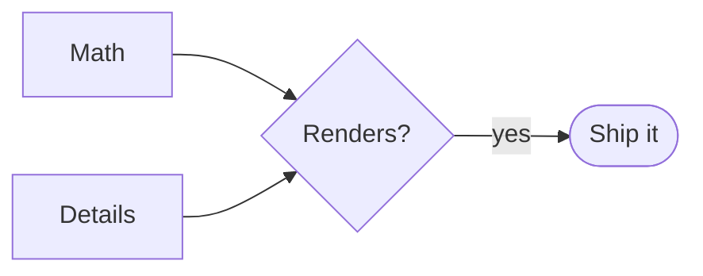

# Math & Collapsible Sections — Test

A scratch document to eyeball the v2.5.0 features. Open it in Markdown Viewer.
If math doesn't render, check **Tools → Settings → Math (KaTeX)** is on.

---

## 1. Inline math

The mass–energy equivalence is $E = mc^2$, and the quadratic roots are
$x = \dfrac{-b \pm \sqrt{b^2 - 4ac}}{2a}$.

Greek and symbols inline: $\alpha, \beta, \gamma, \Delta, \nabla, \infty, \in, \forall$.

Money should **not** turn into math: I paid $5 for lunch and $10 for dinner.

---

## 2. Display math (`$$ … $$`)

$$
\int_0^\infty e^{-x}\,dx = 1
$$

$$
\sum_{n=1}^{\infty} \frac{1}{n^2} = \frac{\pi^2}{6}
$$

$$
\begin{pmatrix} a & b \\ c & d \end{pmatrix}
\begin{pmatrix} x \\ y \end{pmatrix}
=
\begin{pmatrix} ax + by \\ cx + dy \end{pmatrix}
$$

---

## 3. Fenced ` ```math ` block (GitHub style)

```math
\mathcal{L}\{f(t)\} = \int_0^\infty f(t)\, e^{-st}\, dt
```

```math
\frac{\partial u}{\partial t} = \alpha \frac{\partial^2 u}{\partial x^2}
```

---

## 4. Deliberately broken math (should stay visible + flagged, not crash)

```math
\frac{1}{ \unknownmacro{
```

Inline broken: $\frac{1}{$ — the rest of the paragraph keeps rendering.

---

## 5. Collapsible sections (`<details>` / `<summary>`)

<details>
<summary>Click to expand — basic</summary>

Hidden **markdown** content renders normally:

- a list item
- another item with `inline code`

> and a blockquote inside the details.

</details>

<details open>
<summary>Starts open (<code>open</code> attribute)</summary>

This one is expanded by default because of `<details open>`.

</details>

<details>
<summary>Contains a code block and a table</summary>

```cpp
#include <iostream>
int main() { std::cout << "inside details\n"; return 0; }
```

| Col A | Col B |
|:------|------:|
| one   | 1     |
| two   | 2     |

</details>

<details>
<summary>Contains math 🤝</summary>

Euler's identity, hidden away:

$$ e^{i\pi} + 1 = 0 $$

</details>

### Nested details

<details>
<summary>Outer</summary>

Outer body.

<details>
<summary>Inner</summary>

Inner body — nesting works.

</details>
</details>

---

## 6. Other inline HTML now allowed (sanitized by DOMPurify)

Press <kbd>Ctrl</kbd>+<kbd>O</kbd> to open a file.

Chemistry: H<sub>2</sub>O and CO<sub>2</sub>. Powers: E = mc<sup>2</sup>, 10<sup>9</sup>.

<mark>Highlighted text</mark> and an <abbr title="HyperText Markup Language">HTML</abbr> abbreviation.

### Security check — these must NOT execute or appear as live HTML

<script>alert('this should be stripped, not run')</script>

<a href="javascript:alert('xss')">this link's javascript: scheme should be neutralized</a>


If sanitization works, the `<script>` is gone, the link does nothing dangerous,
and no alert ever fires.

---

## 7. Sanity: features that already worked

- [x] Task list item (checked)
- [ ] Task list item (unchecked)


